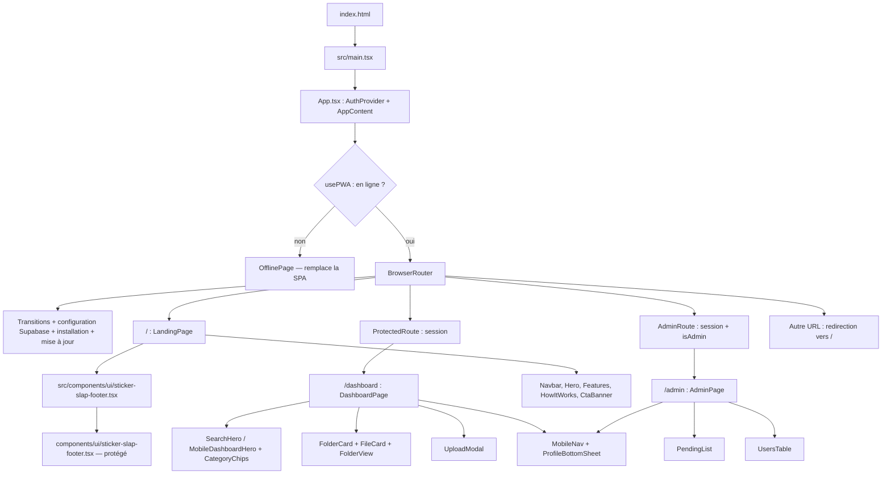
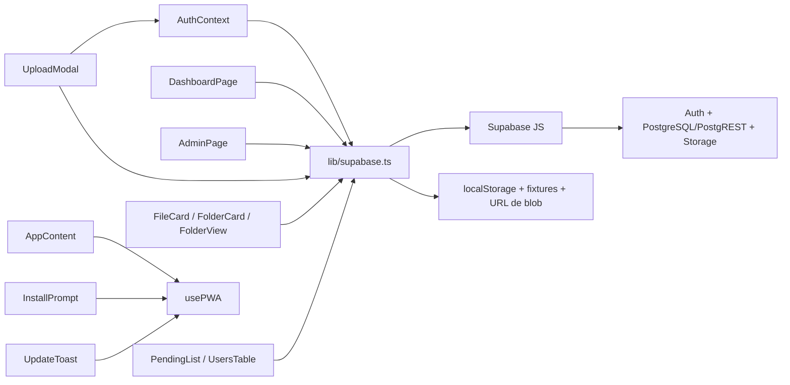
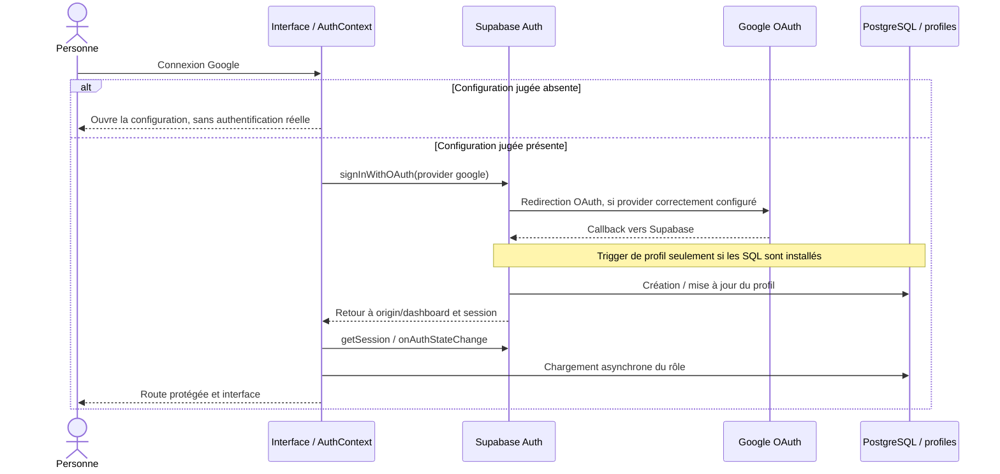
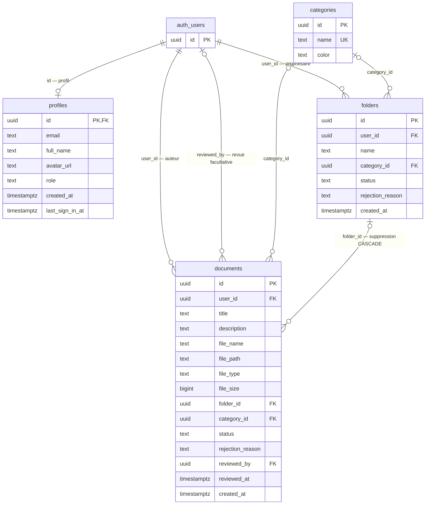

# Architecture et audit de l’existant — AmphixDocs

> **PHASE 1 — analyse uniquement.** Ce document décrit le code local et les contrôles exécutés. Il ne certifie ni le fonctionnement en production, ni la configuration Google/Supabase, ni les autorisations réellement installées sur une base distante. Aucun correctif applicatif n’a été réalisé pendant l’audit.

Documents associés : [ROADMAP.md](ROADMAP.md), [CHECKLIST_MANUELLE.md](CHECKLIST_MANUELLE.md), [instructions de travail](../CLAUDE.md).

## 1. Synthèse et méthode

AmphixDocs est une SPA française React/TypeScript. Elle présente une bibliothèque de documents et de dossiers, un dépôt de fichiers, une authentification Google via Supabase et une interface de modération. Le code contient **à la fois des appels Supabase réels et une branche de démonstration effectivement accessible**.

Les principaux obstacles à une qualification de production sont :

1. TypeScript et le script de lint échouent, bien que Vite construise le site.
2. Les jointures vers `profiles` ne correspondent pas aux clés étrangères déclarées dans les SQL fournis.
3. Les policies UPDATE des documents/dossiers permettent à leur propriétaire de modifier des colonnes de modération.
4. Certaines erreurs API deviennent des tableaux vides, des données de démonstration ou des succès apparents.
5. Les suppressions et les échecs partiels Storage/PostgreSQL ne sont pas récupérés de manière fiable.
6. La progression de transfert est chronométrée ; le dépôt multiple ne remonte que le dernier fichier à l’interface.
7. Le parcours mobile, l’accessibilité et les promesses PWA ne respectent pas encore complètement le contrat produit.

### Légende des statuts

| Statut | Signification dans cet audit |
| --- | --- |
| **FAIT** | Implémentation branchée observée dans le code ou contrôle local réussi, dans le périmètre indiqué. Ne signifie pas « validé en production ». |
| **PARTIEL** | Parcours ou mécanisme présent, mais incomplet, défectueux ou non conforme au contrat. |
| **ABSENT** | Mécanisme non trouvé/configuré dans le périmètre examiné ; préciser ce périmètre. |
| **SIMULÉ** | Données ou résultat de démonstration, fichier factice, pourcentage non mesuré. |

**« Non vérifié à distance/en navigateur » est une limite de preuve**, pas un cinquième statut. La présence d’un appel SDK ne prouve pas qu’il réussit avec les droits effectifs d’une personne connectée.

### Périmètre et limites

- Lecture du manifeste et des configurations, des sources React, des helpers Supabase, des SQL, du README, de `.env.example`, de `.gitignore`, des ressources publiques et du script d’icônes.
- Analyse des imports, cycles et modules sans imports entrants avec Madge.
- Exécution locale de TypeScript, du lint existant et du build Vite/PWA.
- **Aucune lecture/recopie des valeurs de `.env`**, aucune installation/réinstallation, aucune suppression, aucune modification de code, de SQL ou de lockfile.
- Le build demandé a régénéré `dist/` ; cette écriture générée est distincte d’une modification des sources.
- Aucun dépôt Git n’a été observé lors de l’inventaire ; aucune initialisation, aucun commit, aucun push.
- Aucun appel Supabase distant, SQL exécuté, changement OAuth, déploiement ou publication.
- Pas de recette navigateur, de test iOS/Android, de test OAuth réel ou de test de RLS avec des sessions ordinaires.
- `graphify-out/graph.json` est absent. Aucun build Graphify n’a été lancé implicitement pendant la phase en lecture seule. Pour un futur premier build autorisé : `! python -m graphify . --html` ; après une modification de code, utiliser seulement la mise à jour incrémentale.

## 2. Environnement, dépendances et commandes

### Versions observées localement

Les plages du manifeste et les versions installées ne sont pas interchangeables. Le tableau décrit l’environnement observé pendant cet audit ; il ne prescrit pas de mise à jour.

| Élément | Version observée |
| --- | --- |
| Node.js / npm | `v26.3.1` / `12.0.2` |
| TypeScript | `7.0.2` |
| Vite / plugin React | `8.3.5` / `6.2.1` |
| React / React DOM | `19.3.1` |
| React Router DOM | `7.18.5` |
| Supabase JS | `2.118.0` |
| Motion | `12.43.0` ; imports via **`motion/react`** |
| Tailwind / `@tailwindcss/vite` | `4.3.4` ; intégration **v4** |
| `vite-plugin-pwa` | `2.0.0` |
| esbuild | `0.28.2` ; plage à préserver : **`^0.28.0`** |
| `@google/genai` | `2.32.0` ; aucun import trouvé dans les sources applicatives examinées |

Les engines verrouillés de Vite et de son plugin React exigent **Node `^20.19.0 || >=22.12.0`**. Le Node observé les satisfait. Les prérequis « Node 18+ ou 20+ » de `README.md:10` ne sont donc pas suffisants pour ce verrouillage ; choisir une version maintenue compatible lors d’une installation future.

### Scripts réellement configurés

Source : `package.json:7–12`.

| Commande PowerShell | Fonction réelle | Résultat/attention |
| --- | --- | --- |
| `npm run dev` | Vite sur le port 3000, écoute `0.0.0.0` | Serveur de développement, pas validation de production. |
| `npx tsc --noEmit` | Vérification TypeScript | **Échec**, voir section 3. |
| `npm run lint` | Exactement `tsc --noEmit` | **Échec** ; ce n’est pas ESLint. |
| `npm run build` | Build Vite puis génération du service worker | **Réussite avec avertissement** ; ne lance pas TypeScript. |
| `npm run preview` | Service du build local | À employer pour la recette PWA, non exécutée ici. |
| `npm run generate:icons` | Écrit les PNG via `sharp` | Script lu mais non exécuté ; nécessite une autorisation d’écriture. |
| `npm run clean` | `rm -rf dist server.js` | **Ne pas exécuter pendant l’audit** ; suppression et commande Unix. |

Aucun script de tests automatisés et aucun véritable lint ESLint ne sont configurés dans `package.json`.

### Verrouillage et dépendances héritées

- `package-lock.json` et `bun.lock` coexistent.
- Le manifeste et `package-lock.json` utilisent esbuild `^0.28.0` ; la racine de `bun.lock:27` conserve `^0.25.0`.
- Utiliser npm et `package-lock.json`. Ne pas utiliser Bun avant réconciliation explicite ; ne pas supprimer de lockfile et ne pas changer esbuild sans accord.
- `npm ls` a signalé `@emnapi/runtime@1.11.3` comme `extraneous`. Aucune réinstallation n’a été faite pour masquer cet état.
- `@google/genai`, `express` et `dotenv` ne sont pas importés dans `src` selon les recherches ciblées. Leur présence dans le manifeste n’établit pas l’existence d’un backend ou d’une fonctionnalité Gemini opérationnels. Ne pas les retirer automatiquement.
- Le texte d’intégration AI Studio dans `public/assets/aistudio/` est une ressource publique, pas une image ni une fonctionnalité métier. Sa nécessité reste à décider ; aucune suppression n’est autorisée par l’audit.

### Configuration TypeScript et alias

`tsconfig.json` utilise ES2022, les modules ESNext, `moduleResolution: bundler`, `jsx: react-jsx`, `isolatedModules`, `noEmit` et `skipLibCheck`. `allowJs` est activé. Les options `strict`, `noUnusedLocals` et `noUnusedParameters` ne sont pas activées explicitement.

**L’alias `@/*` pointe vers la racine**, pas vers `src/*` : `tsconfig.json:19–24` et `vite.config.ts:105`. Les imports du footer en dépendent ; ne pas « corriger » cet alias par habitude.

## 3. Résultats des contrôles locaux

### TypeScript et lint : échec confirmé

`npx tsc --noEmit` et, séparément, `npm run lint` terminent avec le code de sortie **1** :

```text
src/components/mobile/MobileDashboardHero.tsx(39,20): error TS2339: Property 'file_count' does not exist on type 'FolderItem'.
src/components/mobile/MobileDashboardHero.tsx(39,49): error TS2339: Property 'file_count' does not exist on type 'FolderItem'.
```

`FolderItem` expose `document_count`. `MobileDashboardHero.tsx:39` lit `file_count` deux fois. Ce défaut est localisé mais **n’a pas été corrigé**, conformément à la phase 1.

### Build : réussite, sans validation des types

```text
vite v8.3.5 building client environment for production...
✓ 2155 modules transformed.
dist/assets/index-DnqRMQix.css                 58.47 kB │ gzip: 10.63 kB
dist/assets/index-CO8ALD8l.js                 802.84 kB │ gzip: 231.69 kB
Some chunks are larger than 500 kB after minification.
✓ built in 2.03s

PWA v2.0.0
mode generateSW
precache 20 entries (885.83 KiB)
files generated:
  dist/sw.js
  dist/workbox-2c475f06.js
```

Code de sortie **0**. Le manifeste généré est présent et déclare notamment `lang: fr`, `start_url: /dashboard`, `scope: /` et les icônes 192/512/maskable.

Le chunk principal de **802,84 kB** justifie une analyse de chargement ultérieure. Ce chiffre ne mesure ni le temps d’interaction sur téléphone ni le comportement du réseau réel. Ne pas supprimer une dépendance utile ou relever le seuil uniquement pour faire disparaître l’avertissement.

### Graphe des imports

Commande d’analyse, sans installation :

```powershell
npx --no-install madge --json --extensions ts,tsx --ts-config tsconfig.json src components
```

Madge `8.0.0` a traité 43 fichiers lors des contrôles de l’audit. Aucun cycle n’a été détecté dans ce périmètre. Deux dépendances ont été ignorées par l’analyse : **`virtual:pwa-register`** et **`tailwindcss`**. Le graphe statique ne modélise donc pas tout le traitement Vite/CSS/PWA.

Modules sans imports entrants signalés :

- `src/main.tsx` : **normal**, point d’entrée référencé par `index.html`.
- `src/components/DocumentCard.tsx` : ancienne variante de carte, **non branchée** ; la carte actuelle est `FileCard.tsx`.

Le footer racine, les composants mobiles et les hooks PWA sont réellement importés. Aucun fichier ne doit être supprimé à partir du seul résultat « orphelin ».

## 4. Structure de la SPA et dépendances principales

```text
index.html → src/main.tsx → src/App.tsx
src/pages/                LandingPage, DashboardPage, AdminPage
src/context/              AuthContext
src/lib/supabase.ts        client, configuration, types, helpers réels et démo
src/components/           cartes, dépôt, recherche, modération, sections landing
src/components/mobile/    navigation en pilule et bottom sheets
src/components/pwa/       installation, mise à jour et hors-ligne
src/components/ui/        GlyphPortal et re-export du footer
components/ui/            implémentation protégée du StickerSlapFooter
src/hooks/                PWA, viewport mobile, direction de scroll
supabase/                 schema.sql puis migration_v2.sql
public/                   ressources et icônes
```

### Routes, montage et pages



- Les trois routes sont réellement montées. Un dossier ouvert est un **état local `openedFolderId`**, pas une route avec identifiant.
- `ProtectedRoute` et `AdminRoute` protègent le rendu React ; ils ne remplacent jamais les RLS.
- `App.tsx:24–26` sélectionne la page hors-ligne avant le router. L’application privée n’est donc pas consultable hors-ligne par ce mécanisme.
- `location.state.openUpload` est consommé par `DashboardPage.tsx:56`. En revanche, les hashes `#search` et `#folders` ne pilotent pas ses états de recherche/dossiers.

### Couplages à connaître avant une correction



`supabase.ts` concentre les contrats, l’accès réseau, la démonstration et plusieurs décisions de visibilité. Les trois appels de `usePWA` créent des états/listeners/enregistrements distincts ; cela justifie une mutualisation, mais ne prouve pas à lui seul une panne de mise à jour.

## 5. Authentification, configuration et démonstration

### Configuration du client

`src/lib/supabase.ts:4–43` :

1. Lecture de `VITE_SUPABASE_URL` et `VITE_SUPABASE_ANON_KEY`.
2. Lecture de `amphix_supabase_url` et `amphix_supabase_anon_key` dans `localStorage`.
3. **Priorité localStorage > environnement**.
4. Heuristique `isConfigured` : valeurs non vides, URL HTTPS et rejet de deux placeholders anglais.
5. Création d’un client factice si non configuré ; `reinitializeSupabase` enregistre puis recrée le client.

Les placeholders français de `.env.example` ne sont pas rejetés par cette heuristique. Une configuration invalide peut donc être présentée comme « Connecté » sans test. Les accès `localStorage` ne sont pas tous protégés par `try/catch`, y compris au chargement du module ; le stockage bloqué peut faire échouer l’initialisation.

`SupabaseConfigModal.tsx` permet la saisie de la configuration et affiche des instructions OAuth. Elle conserve des références de configuration codées en dur et des messages qui ne doivent pas être pris pour une observation du projet distant. Une clé de client Supabase est publique, mais **une clé `service_role`, une clé privée Google ou une clé Gemini n’a aucune place dans le navigateur**. La nature de la clé effectivement configurée n’a pas été vérifiée.

### Flux Google décrit par le code — non testé à distance



`AuthContext.tsx` appelle `signInWithOAuth` avec un retour `${window.location.origin}/dashboard`. En iframe, `skipBrowserRedirect` est utilisé et une fenêtre est ouverte. Le contexte traite aussi les erreurs OAuth présentes dans l’URL. Il n’existe pas de route callback applicative dédiée : **callback Google → Supabase** et **retour Supabase → application** sont deux configurations différentes, détaillées dans la checklist.

### État session/rôle

- La session est chargée et surveillée via `getSession` et `onAuthStateChange`.
- `loadRole` n’est pas attendu avant `setLoading(false)` (`AuthContext.tsx:123–140`). Une visite directe de `/admin` peut donc être évaluée avant la fin du chargement du rôle ; scénario à reproduire, pas incident navigateur démontré ici.
- Erreur ou profil absent deviennent silencieusement le rôle `user`.
- Le chargement du rôle n’a pas de garde de fraîcheur associée au compte courant.
- `refreshUserRole` existe, mais aucune souscription aux changements de `profiles` n’est démontrée. La promesse README d’un lien admin apparaissant « instantanément » n’est donc pas validée.

### Démonstration réellement branchée

- Session factice restaurée depuis `amphixdocs_demo_session` lorsque Supabase est non configuré.
- Fixtures de documents, dossiers, catégories et utilisateurs dans `supabase.ts`.
- Dépôt démo : URL de blob et métadonnées localStorage, sans fichier durable entre sessions/rechargements.
- Téléchargement d’une fixture sans blob : création d’un fichier texte factice.
- Fallback de catégories vers des identifiants tels que `cat-contrats`, **non UUID**, y compris après une erreur réelle.
- `fetchUsersList` peut renvoyer les personnes démo après un échec réel.
- `fetchDashboardData` convertit des erreurs SDK en listes vides ; son `catch` renvoie des données démo **sans le filtre de visibilité de la branche démo normale**.
- `fetchUserRole` accepte `amphix_force_admin` même lorsque Supabase est configuré (`supabase.ts:413–438`). Ce réglage falsifie le rôle de l’interface, **pas le JWT ni les RLS serveur**.

Ces comportements interdisent de présenter les écrans observés comme preuve d’une bibliothèque ou d’une administration de production opérationnelles.

## 6. PostgreSQL, relations et autorisations

### Ordre des scripts et modèle déclaré

`supabase/schema.sql` crée les documents initiaux, active leurs RLS et crée/configure le bucket privé. `supabase/migration_v2.sql` ajoute profils, catégories, dossiers, modération et accès étendu.

Les scripts ont été **lus, pas exécutés**. Sur une base existante, `CREATE TABLE IF NOT EXISTS` et `ADD COLUMN IF NOT EXISTS` ne garantissent pas que toutes les contraintes/policies sont conformes. Plusieurs créations de policies ne sont pas rejouables telles quelles. Inventorier la base avant toute migration ; ne pas relancer aveuglément le script initial.



Points de contrat :

- `profiles.role` : `user` ou `admin`, non nullable.
- `folders.status` et `documents.status` : `pending`, `approved`, `rejected`, défaut `pending` et non nullables.
- `documents.folder_id` est nullable ; sa FK est **`ON DELETE CASCADE`** (`migration_v2.sql:168`). Supprimer un dossier supprime donc ses lignes documents, **pas leurs objets Storage**.
- Les catégories sont référencées avec `ON DELETE SET NULL`.
- `folders` ne possède pas de colonnes `reviewed_by`/`reviewed_at` ; celles-ci existent seulement sur `documents`.
- Les SQL ne déclarent **aucune FK directe de `documents.user_id` ou `folders.user_id` vers `profiles.id`**. Les requêtes `.select('*, profiles:user_id(...)')` (`supabase.ts:499,505,598,716`) ne sont donc pas justifiées par les relations fournies. Une erreur PostgREST reste à reproduire sur une instance autorisée ; ne pas inventer son code ni supposer la relation installée.
- La policy de lecture des profils est limitée à soi-même ou à admin. Même après correction de la relation, la présentation de l’auteur d’un fichier approuvé doit respecter ce périmètre et la confidentialité des champs, notamment l’e-mail.
- Aucune contrainte SQL de description ≤ 200 caractères, de taille non négative/≤ 20 Mo ou de cohérence dossier/document/propriétaire n’est déclarée dans ces scripts.
- Plusieurs champs SQL peuvent être nuls alors que les interfaces TypeScript les exigent en `string`/`number`. Le client n’est pas paramétré par un type `Database` généré ; les `any`/casts masquent une partie du contrat.

### Fonctions et profil

`is_admin()` (`migration_v2.sql:25`) est une fonction SQL `SECURITY DEFINER`, `STABLE`, avec `search_path = public`, qui vérifie `profiles.role` pour `auth.uid()`.

`handle_new_user()` (`migration_v2.sql:39`) crée un profil avec le rôle `user` depuis les métadonnées Auth. En conflit, elle actualise les informations du profil sans écraser le rôle. Un backfill couvre les utilisateurs déjà présents.

Le trigger `on_auth_user_created` est déclenché **après tout INSERT ou UPDATE d’`auth.users`** (`migration_v2.sql:67`), pas uniquement après une connexion. Il fixe `last_sign_in_at` à `NOW()`. La date affichée comme « dernière connexion » n’est donc pas garantie fidèle à la sémantique Auth.

### Matrice RLS déclarée, après les deux scripts

Toutes les policies ci-dessous visent `authenticated`. « Propriétaire » signifie comparaison avec `auth.uid()` ; « admin » signifie `public.is_admin()` côté SQL.

| Ressource | SELECT | INSERT | UPDATE | DELETE |
| --- | --- | --- | --- | --- |
| `profiles` | Soi-même ou admin | Pas de policy de création client ; trigger privilégié | Admin, avec USING et WITH CHECK `is_admin()` | Pas de policy client déclarée |
| `categories` | Tout compte authentifié | Pas de policy déclarée | Pas de policy déclarée | Pas de policy déclarée |
| `folders` | Propriétaire, admin ou statut approved | Propriétaire et statut pending | Propriétaire ou admin ; pas de restriction supplémentaire de colonnes/statut | Propriétaire ou admin |
| `documents` | Propriétaire, admin ou statut approved | Propriétaire et statut pending, ou propriétaire admin | Propriétaire ou admin ; pas de restriction supplémentaire de colonnes/statut | Propriétaire ou admin |
| `storage.objects`, bucket documents | Préfixe personnel, admin ou chemin d’un document approved | Préfixe personnel | Préfixe personnel | **Préfixe personnel seulement** |

Références : `migration_v2.sql:87–99`, `111`, `143–164`, `181–224` ; `schema.sql:68–110` pour Storage.

**Défaut de modération statiquement établi :** les policies UPDATE folders/documents autorisent leur propriétaire sans verrouiller `status`, `rejection_reason` ou les métadonnées privilégiées. Le WITH CHECK implicite réutilisant USING ne protège pas ces colonnes. Un INSERT forcé à `pending` ne protège pas une UPDATE ultérieure. Les colonnes `file_path`, `user_id` et les relations de dossier doivent également être contrôlées côté serveur, pas uniquement par les formulaires.

La visibilité Storage utilise notamment l’existence d’un document `approved` avec `file_path = name`. La cohérence de cette métadonnée avec l’objet et son propriétaire est donc une frontière de sécurité. Aucun scénario d’accès distant n’a été exécuté pendant l’audit.

**À ne pas confondre :** les policies de `profiles` ne démontrent pas une auto-promotion SQL par un utilisateur ordinaire. L’override local admin concerne React ; le défaut serveur constaté concerne principalement les colonnes modifiables des dossiers/documents.

### Policies anciennes et bucket

- La migration supprime explicitement les quatre anciennes policies de `documents` avant leur remplacement. Elles ne doivent pas être présentées comme toutes cumulées après cette séquence.
- L’ancienne SELECT Storage personnelle reste en place. Son périmètre est déjà inclus dans la nouvelle SELECT étendue.
- Les policies permissives PostgreSQL se combinent par **OR**. Sur une base réelle, inventorier **toutes** les policies, y compris celles non présentes dans les fichiers locaux.
- `schema.sql:63` force `public = false` et `file_size_limit = 20971520` sur un bucket existant via `ON CONFLICT ... DO UPDATE`. Cette instruction n’a pas été exécutée ici ; l’état réel du bucket n’est pas connu.
- La migration étend la lecture Storage à admin, mais **pas sa suppression des objets d’autrui**, contrairement aux DELETE SQL.

## 7. Flux métier et échecs partiels

### Dépôt

```mermaid
sequenceDiagram
  actor Personne
  participant Modal as UploadModal
  participant Helper as supabase.ts
  participant Storage as Storage / documents
  participant SQL as PostgreSQL / documents
  Personne->>Modal: Fichiers + métadonnées
  Modal->>Modal: Contrôle 20 Mo/fichier et description 200 caractères
  opt Nouveau dossier
    Modal->>Helper: createFolderItem, statut pending
    Helper->>SQL: INSERT folders
  end
  loop Chaque fichier, séquentiellement
    Modal->>Helper: uploadUserDocument
    Helper-->>Modal: Pourcentage par minuteur, non mesuré
    Helper->>Storage: upload sur userId/UUID-nom
    alt Upload réussi
      Helper->>SQL: INSERT documents, statut pending + sélection auteur
      alt Erreur SQL retournée
        Helper->>Storage: remove en compensation
        Note over Helper,Storage: Résultat de compensation ignoré
        Helper-->>Modal: Erreur ; lot partiellement terminé possible
      else Succès
        Helper-->>Modal: Document créé
      end
    else Erreur Storage
      Helper-->>Modal: Erreur explicite
    end
  end
  Modal-->>Personne: Succès affiché
  Note over Modal,Helper: onSuccess ne remonte que le dernier document
```

Implémentation présente : sélection multiple, drag-and-drop, capture photo mobile, titre, catégorie, dossier existant/nouveau, limite UI de 20 Mo et `maxLength={200}`. Références : `UploadModal.tsx:32,118,200–231,550` ; `supabase.ts:560,620`.

Limites :

- **Transfert réel, progression simulée**, y compris en mode Supabase : `setInterval` augmente le pourcentage jusqu’à 85 %, puis 90/100 représentent des étapes, pas des octets (`supabase.ts:676–716`).
- Le helper ne refait pas lui-même tous les contrôles de taille/longueur ; le bucket protège seulement son propre niveau de stockage si correctement configuré.
- La compensation après `dbError` existe, mais l’erreur de `remove` est ignorée. Le timer n’est pas protégé par un `finally` contre toute exception inattendue.
- Le dossier est créé avant les fichiers ; aucun traitement fiable du dossier vide en échec n’est prévu.
- Après N succès, seul le dernier document rejoint l’état local du dashboard. Les autres documents et compteurs apparaissent seulement après rechargement/fetch éventuel.
- Si le lot échoue au milieu, les succès précédents ne sont pas restitués comme un bilan récupérable ; une nouvelle tentative peut répéter le dépôt.
- Le formulaire n’est pas entièrement verrouillé pendant le transfert. Sa réinitialisation dépend également de la référence de `categories`.
- Les URL de blobs démo ne constituent pas un stockage durable ; aucune révocation n’a été trouvée dans les recherches ciblées.

### Consultation, édition et suppression

`getDocumentSignedUrl` (`supabase.ts:746`) crée une URL valable **60 secondes** en mode réel. `FileCard.tsx:65` ouvre une fenêtre après une opération asynchrone ; tester l’ouverture sur les navigateurs qui bloquent les fenêtres différées. Les erreurs de téléchargement sont principalement journalisées, sans message actionnable.

`updateDocumentMetadata` (`supabase.ts:764`) met à jour par `id`. L’argument `userId` n’est pas utilisé en mode réel ; il ne constitue donc ni un contrôle de droits supplémentaire, ni un filtre bloquant spécialement admin. Les droits dépendent de la RLS. L’absence d’erreur ne confirme pas qu’une ligne a effectivement été modifiée.

`deleteDocumentItem` (`supabase.ts:792`) :

1. Appelle `Storage.remove` **sans examiner son erreur**.
2. Supprime ensuite la ligne SQL et ne vérifie que cette erreur SQL.
3. L’interface peut retirer l’élément après ce succès apparent.

Conséquences : objet restant après suppression SQL, notamment pour admin ; ou ligne restante avec objet absent si Storage réussit puis SQL échoue. Aucun contrôle du nombre de lignes supprimées n’est prévu.

`deleteFolderItem` (`supabase.ts:804`) supprime seulement le dossier SQL. La FK CASCADE supprime les lignes documents, mais **aucun objet Storage contenu dans ce dossier n’est supprimé**. Les objets deviennent orphelins. Storage et SQL ne partagent pas une transaction ; il faut un protocole de reprise/compensation, pas une promesse d’atomicité inexistante.

### Modération et rôles

- `PendingList` est réellement monté dans `/admin`, avec filtre, tri, approbation/refus et aperçu signé de fichier.
- `setItemApprovalStatus` (`supabase.ts:822`) appelle UPDATE et vérifie `error`. Les colonnes de revue documents proviennent du client. Aucun résultat de ligne affectée ni validation serveur du motif n’est démontré.
- Un motif vide peut être remplacé par un motif générique ; les erreurs de modération sont surtout en console. L’aperçu dossier n’est pas une consultation complète de son contenu.
- **Approbation collective incohérente** : la confirmation annonce `filteredList.length` (`PendingList.tsx:213–220`), mais `approveAllPendingItems` (`supabase.ts:869`) met à jour **tous les pending des deux tables**. Les résultats des deux requêtes sont ignorés et les mises à jour ne sont pas transactionnelles.
- `UsersTable` utilise réellement `updateUserRole` (`supabase.ts:925`), mais sans confirmation de ligne affectée. L’interface bloque la modification de son propre rôle ; les SQL ne définissent pas explicitement une règle métier protégeant le dernier admin ou la rétrogradation de soi-même.
- `fetchUsersList` compte les documents avec une seconde requête dont l’erreur est ignorée et peut renvoyer des fixtures après un échec.
- Aucun champ ni filtre de provider n’établit que toutes les inscriptions présentées sont issues de Google. `last_sign_in_at` exige également une clarification de sa source.

## 8. Recherche, dashboard et mobile

### Recherche réellement implémentée

`DashboardPage.tsx:142–158` :

- Debounce de 250 ms après `trim` de la requête.
- Recherche locale sur titre, description et nom de fichier ; sur le nom pour les dossiers.
- Filtre par `category_id`.
- Séparation des dossiers et fichiers racine (`!folder_id`).
- Ouverture d’un dossier vers `FolderView`, qui affiche ses fichiers chargés.

**Angle mort** : un fichier correspondant à la recherche mais rangé dans un dossier dont le nom ne correspond pas peut être absent des résultats. Les noms de catégories ne sont pas recherchés, malgré le placeholder de recherche. Les suggestions en dur de `SearchHero` sont des raccourcis de saisie, pas des résultats métier.

### État de chargement et erreurs

`loadingDocs` existe (`DashboardPage.tsx:33`) et est mis à jour par `loadData` (`:68`), mais n’est pas rendu. Le `catch` ne fait qu’un `console.error`. Combiné aux erreurs masquées par le helper, un échec peut ressembler à une bibliothèque vide ou à aucune demande à approuver.

### Contrat « action d’abord »

- Desktop : `SearchHero` et dépôt sur l’accueil ; résultats après recherche.
- Mobile : `MobileDashboardHero` affiche également catégories et carte « Récents » dès l’accueil (`DashboardPage.tsx:314–322`). Le contrat strict « seulement grande recherche et dépôt avant recherche » n’est pas respecté.
- Certains fichiers récents n’ont pas d’action d’ouverture ; les dossiers récents utilisent une zone cliquable sans interaction clavier équivalente.

### Navigation mobile

La pilule est présente avec les cinq destinations et le bouton central orange. `MobileNav` calcule son onglet actif depuis pathname/hash (`MobileNav.tsx:38–39`).

Les callbacks Dashboard (`DashboardPage.tsx:441–448`) utilisent `setSearchQuery(' ')`. Cette valeur est trimée en chaîne vide et n’active pas la recherche. La ref visée appartient au header monté seulement dans un autre état. Aucun état distinct de l’onglet Dossiers n’est piloté.

Depuis admin, la navigation vers `/dashboard#search` ou `/dashboard#folders` (`AdminPage.tsx:275–276`) ne résout pas ce problème : le dashboard ne consomme pas ces hashes. Accueil, recherche, dossiers, profil et dépôt doivent partager une source de vérité.

Safe areas, espaces de navigation et plusieurs hauteurs `dvh` sont présents. Le comportement clavier utilise `VisualViewport`, avec une heuristique de hauteur à tester ; aucune recette à 320 px ou sur appareil réel n’a été faite.

## 9. Design, français et accessibilité

### Identité visuelle à préserver

Palette et DM Sans sont présents dans le CSS et les appels des composants. Tailwind v4 et `motion/react` sont effectivement utilisés. Les springs, stickers et cartes 3D sont des choix de design à préserver pendant les corrections, pas à supprimer globalement pour simplifier le travail.

### Reduced-motion : couverture partielle

Des gardes existent dans `Features`, `HowItWorks`, le portail et certaines animations du footer. Aucun `MotionConfig` global ni règle globale suffisante n’a été trouvé dans le périmètre examiné. De nombreux loaders/badges, flips 3D, springs, transitions de pages et compteurs restent sans garde adaptée. Il faut contrôler aussi les animations JavaScript, pas seulement le CSS.

### Interactions et dialogues

| Zone | Présent | Limite observée |
| --- | --- | --- |
| `UploadModal` | Nom accessible, `role=dialog`, `aria-modal`, erreur `alert`, fermeture sûre pendant transfert, hauteur `dvh` | Pas de gestion complète du focus initial/trap/restauration ou du scroll de fond ; progression sans sémantique de progressbar. |
| `BottomSheet` | Dialogue nommé, Échap, verrou de scroll, `90dvh` | Pas de trap/restauration/inert ; le verrou de scroll ne préserve pas un verrou précédent. |
| Configuration / installation iOS / confirmations | Interfaces et actions présentes | Contrat de dialogue, labels associés, focus et Échap incomplets. |
| Cartes fichier/dossier et récents | Clic, animations, téléchargement/édition | Zones non sémantiques, action clavier manquante, erreurs peu visibles ; faces 3D non rendues inertes. |
| Catégories / badges / motifs | Sélection visuelle et badges des trois statuts | États sélectionnés et tooltip de motif insuffisamment annoncés ; motif difficile à utiliser au clavier. |
| Administration | `tablist`, `tab`, `aria-selected` | Associations aux panels et clavier à vérifier ; popovers/confirmations et labels incomplets. |
| Toast de mise à jour | Message et boutons | Pas d’annonce `aria-live`/status locale ; safe-top à tester. |

Ces constats sont statiques ; ils ne remplacent pas une recette clavier/lecteur d’écran et un contrôle à 320 px, clavier ouvert et safe areas actives.

### Footer protégé : limite de contrat explicite

L’appel de `LandingPage` utilise des props françaises, la palette demandée, `socials={[]}` et `credits={[]}` (`LandingPage.tsx:82–83`). Le re-export pointe bien vers `components/ui/sticker-slap-footer.tsx`.

Un `MutationObserver` de la landing modifie cependant le titre du bouton de copie (`LandingPage.tsx:24`) : c’est une traduction **hors props**, incompatible avec la règle de configuration.

L’API du composant ne permet pas de traduire toutes ses annonces internes : copie d’e-mail, lien d’accueil, instructions et labels de stickers notamment. **Français intégral + props uniquement + implémentation immuable ne sont pas simultanément satisfaits par l’API actuelle.** Consigner cette limite et attendre une décision explicite ; ne pas modifier l’implémentation, le re-export, ni ajouter de contournement DOM/wrapper.

Le portail contient également des annonces internes anglaises. Les promesses README et les textes PWA doivent être distingués des fonctions réellement disponibles.

## 10. PWA, ressources et déploiement

### Configuration observée

`vite.config.ts:18–99` utilise `VitePWA` avec `registerType: prompt` et `generateSW` :

- Précache statique JS/CSS/HTML/icônes/polices.
- Navigation fallback vers `/index.html`.
- **`NetworkOnly` pour les URL HTTPS standard `*.supabase.co`** (`:60–61`).
- `CacheFirst` pour Google Fonts, avec limites d’expiration.
- Options de développement activées ; `usePWA` enregistre explicitement le SW uniquement en production.
- Manifest français, mode standalone, orientation portrait, couleurs papier/cobalt et icônes 192/512/maskable.

Cette configuration ne démontre pas un cache Supabase accidentel. Elle ne constitue pas non plus une validation de **tous** les chemins Auth/REST/Storage/URL signée/temps réel ou domaines personnalisés. Le critère produit reste : aucun cache applicatif de ces appels. Examiner les règles effectives et les caches d’un build de production autorisé.

### Comportement réellement branché

- `usePWA` écoute online/offline et l’événement d’installation ; import du registre SW en production.
- `InstallPrompt`, `UpdateToast` et `OfflinePage` sont montés.
- Lecture de certaines préférences localStorage sans garde ; erreurs d’enregistrement capturées silencieusement.
- Détection iOS par user-agent, sans couverture démontrée de tous les iPadOS.
- Les trois instances du hook ne partagent pas un état unique.

### Promesses non tenues

- La page hors-ligne remplace l’ensemble de l’application.
- Aucun mécanisme durable de documents privés hors-ligne n’est implémenté dans le périmètre observé.
- Aucune file persistante de transferts ou de mutations à synchroniser n’est implémentée.
- Les textes promettant un accès aux documents hors-ligne ou une synchronisation automatique sont donc trompeurs. Un nouveau fetch à la reconnexion n’est pas une synchronisation durable.
- Installation, lancement standalone, cycle de mise à jour entre deux builds et absence de cache privé **non testés**.

### Ressources et hébergement

Les SVG/PNG d’icônes et apple-touch-icon existent. `scripts/generate-icons.js` a été lu mais non exécuté ; le rendu dépend notamment des polices locales. La présence des fichiers ne vaut pas recette d’icône sur iOS/Android.

`vercel.json` contient le rewrite SPA et un cache immutable des assets. Aucun déploiement ni en-tête effectif n’a été testé. Le README emploie des promesses « 100% prêt » et présente la migration v2 comme complète, alors qu’elle dépend de `schema.sql` et que les blocages décrits ici subsistent. Ses commandes Git/déploiement ne sont pas une autorisation de les exécuter.

`.gitignore` exclut `.env*` et réautorise `.env.example`. Vérifier l’exclusion effective et l’absence de secrets avant tout futur commit **demandé**. Les nouvelles instructions ne recopient ni adresse personnelle ni référence de projet codée en dur.

## 11. Matrice fonctionnelle récapitulative

| Fonction | Statut | Preuve et limite principale |
| --- | --- | --- |
| Landing et sections attendues | **FAIT** | Sections montées ; recette visuelle/accessibilité non exécutée. |
| Footer sans réseaux sociaux ni credits | **FAIT** | Props vides ; traduction intégrale bloquée séparément. |
| Français intégral / footer par props uniquement | **PARTIEL** | Patch DOM existant et chaînes internes non paramétrables. |
| Guards session et admin React | **FAIT** | Guards branchés ; ne prouvent pas les RLS et attente du rôle incomplète. |
| Auth Google de bout en bout | **PARTIEL** | Appel SDK, retour et erreurs présents ; configuration/connexion réelles non vérifiées. |
| Démonstration et téléchargements de fixtures | **SIMULÉ** | Compte factice, données localStorage, blobs/fichiers texte. |
| Bibliothèque depuis Supabase | **PARTIEL** | Requêtes réelles ; relation profiles et erreurs masquées. |
| Dashboard action d’abord | **PARTIEL** | Desktop proche du contrat ; récents/catégories avant recherche sur mobile. |
| Recherche catégories/dossiers/fichiers | **PARTIEL** | Recherche locale ; angle mort des fichiers en dossier et noms de catégories. |
| Ouverture d’un dossier | **FAIT** | `FolderView` branché ; dépend des données déjà chargées. |
| Dépôt réel Storage + SQL | **PARTIEL** | Appels réels ; contrats, compensation et lot incomplets. |
| Pourcentage de transfert | **SIMULÉ** | Minuteur, même en mode réel. |
| Limite 20 Mo et description 200 caractères | **PARTIEL** | UI et bucket déclaré ; contrôles SQL/helper incomplets, bucket distant non vérifié. |
| Statuts et badges auteur | **PARTIEL** | Statuts/badges et SELECT déclarés ; UPDATE propriétaire compromet la modération. |
| Suppression complète document/dossier | **PARTIEL** | Appels présents ; erreurs Storage ignorées et objets orphelins. |
| Modération individuelle / motif / aperçu | **PARTIEL** | Helpers réels ; droits, erreurs, motif et aperçu dossier incomplets. |
| Approbation collective | **PARTIEL** | Périmètre global différent de la confirmation filtrée ; erreurs ignorées. |
| Inscriptions et promotion de rôle | **PARTIEL** | Appels réels ; fallback démo, source Google/date et règles métier non garanties. |
| Pilule mobile reliée au dashboard | **PARTIEL** | Pilule visible ; hashes/callbacks et états incohérents. |
| Manifest, icônes et SW généré | **FAIT** | Build local réussi ; installation/update non vérifiées. |
| Page hors-ligne | **FAIT** | Écran branché ; ne donne pas accès aux documents privés. |
| Documents privés hors-ligne / file de synchronisation | **ABSENT** | Aucun mécanisme durable observé ; ne pas promettre ces fonctions. |
| Interdiction du cache Supabase | **PARTIEL** | NetworkOnly déclaré pour domaine standard ; recette de tous les endpoints absente. |
| Accessibilité et reduced-motion complets | **PARTIEL** | Plusieurs dispositifs présents ; nombreux parcours incomplets. |
| Vérification TypeScript / lint local | **PARTIEL** | Commandes existantes, toutes deux en échec. |
| Tests automatisés / véritable ESLint | **ABSENT** | Aucun script/configuration correspondante dans le périmètre du projet examiné. |
| Déploiement validé / recette des RLS et OAuth | **ABSENT** | Aucune validation effectuée pendant l’audit ; ne signifie pas qu’aucun projet distant existe. |

## 12. Suite autorisée et points de décision

La phase 1 livre ce constat, la roadmap et la checklist, puis s’arrête. **Aucune tâche d’implémentation n’est cochée et la phase 2 attend le feu vert explicite.**

À résoudre avant de qualifier le produit :

- Environnement distant de test autorisé et comptes A/B/admin, sans collecte de secrets dans la conversation.
- Contrat de profils d’auteurs et champs publiables ; droits de dépôt dans un dossier existant.
- Règle métier du dernier admin et de la rétrogradation de soi-même.
- Stratégie serveur de modération et de reprise Storage/SQL, sans clé privilégiée livrée au navigateur.
- Décision sur la contradiction de traduction du footer protégé, sans supposer une exception à son immutabilité.

Ces décisions sont des dépendances de la phase 2, pas des manipulations externes déjà réalisées. Suivre [ROADMAP.md](ROADMAP.md) dans l’ordre et conserver les preuves de [CHECKLIST_MANUELLE.md](CHECKLIST_MANUELLE.md).
